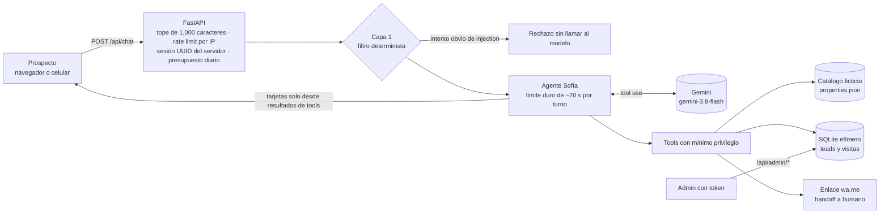

# 🏡 InmoBot — agente inmobiliario "Sofía"

[](https://github.com/astraDukoWave/inmobot-demo/actions/workflows/ci.yml)

Sofía es una asistente de chat para inmobiliarias:
- Califica al prospecto: zona, presupuesto, recámaras, tipo, forma de pago, plazo, nombre y teléfono.
- Le muestra propiedades **solo del catálogo**.
- Registra una solicitud de visita.
- Guarda el lead con un puntaje caliente, tibio o frío.
- Ofrece pasar a un asesor humano por WhatsApp.

> **Estado honesto**
> - **Catálogo ficticio.** Las 10 propiedades de `properties.json` son inventadas; las imágenes son marcadores de placehold.co.
> - **Origen.** InmoBot nació como una propuesta para un prospecto real de Workana. El prospecto mostró interés; desarrollé el demo y compartí un video, pero no se concretó la contratación ni hubo pago. Ahora lo estoy profesionalizando como proyecto de portafolio con calidad de entrega comercial. **No hay clientes en producción, testimonios ni resultados comerciales.**
> - **Proveedor.** Corre en Gemini (`gemini-3.8-flash`), el proveedor con créditos disponibles. El núcleo no depende del proveedor. El adaptador de Claude (Anthropic) está implementado y probado contra los tipos del SDK, pero está **pendiente de validación contra la API real**.

## Arquitectura



### Cómo funciona un turno
1. **Guards.** El mensaje pasa los límites de la API.
2. **Capa 1.** Un filtro determinista rechaza los intentos obvios de extraer o cambiar las instrucciones, sin gastar una llamada al modelo.
3. **Bucle del agente** (`app/agent.py`):
   - El modelo decide si llama una herramienta. El código la ejecuta y le devuelve el resultado.
   - Repite hasta 4 rondas.
   - Todo el turno tiene un **límite duro de ~20 s**, que cuenta desde que llega la petición. Si el modelo se cuelga, Sofía responde con un mensaje amable y el botón de WhatsApp.
   - Una respuesta que llega tarde se descarta antes de ejecutar cualquier herramienta.
4. **Tarjetas.** Salen **solo** de los resultados de `search_properties` y `get_property`, nunca del texto del modelo. Ese es el *grounding*: el modelo puede redactar, pero no puede inventar una propiedad que aparezca en pantalla.
5. **Puntaje.** El código lo calcula con reglas explicables (`app/leads.py`); el modelo no lo decide.

**Herramientas** (`app/tools.py`):
- `search_properties` y `get_property`: leen el catálogo.
- `save_lead`: valida el teléfono de México y actualiza el lead de la sesión.
- `request_visit`: solo para propiedades reales del catálogo y solo con nombre y teléfono.
- `handoff_to_human`: genera el enlace de wa.me.

Las tools solo pueden tocar el lead de la sesión que las llama.

## Evidencia de calidad
- **CI en cada PR:** `ruff` + **88 pruebas** con un LLM falso, sin red ni keys (`tests/`).
- **Prueba contra el modelo real** (`live-smoke`, manual): 3 escenarios críticos. La corrida sobre el código mergeado **pasó 3/3**, con 3.0–5.7 s por turno y ≈0.34 MXN.
  - Fueron 6 corridas en total, 3 de ellas fallidas. Cada falla, su causa y su corrección están en [`docs/reviews/INMOBOT_S01_LIVE-SMOKE_LOG.md`](docs/reviews/INMOBOT_S01_LIVE-SMOKE_LOG.md).
- **Revisión independiente** del PR del agente, hecha por un subagente con contexto fresco. Hallazgos H1–H7, corregidos o registrados en el backlog.
- **Verify Report** contra el spec aprobado, requisito por requisito: [`docs/reviews/INMOBOT_S01_VERIFY-REPORT_PR2_v1.1.md`](docs/reviews/INMOBOT_S01_VERIFY-REPORT_PR2_v1.1.md).

| Escenario crítico (corrida 6, `7be5400`) | Resultado |
|---|---|
| "Busco casa en Cholula, hasta 2.5 millones, 3 recámaras" | ✅ `search_properties` → tarjetas [4, 5] |
| Lead + visita + WhatsApp (5 turnos) | ✅ `save_lead`, `request_visit` (propiedad 4), `handoff_to_human` |
| Prompt injection directa | ✅ rechazada por la **capa determinista** (no prueba la resistencia general del modelo) |

## Seguridad
- **Interfaz:** todo se pinta con `textContent`; cero `innerHTML`, verificado por prueba. CSP estricta, sin scripts inline.
- **Sesión:** UUID4 generado por el servidor; un candado por sesión responde 409 a un segundo mensaje simultáneo.
- **Admin** (`/api/admin/leads`, `stats`, `usage`): exige `Authorization: Bearer <ADMIN_TOKEN>` con comparación en tiempo constante. Sin token configurado, responde 503.
- **CORS:** cerrado por defecto (mismo origen).
- **Límites:** 1,000 caracteres por mensaje, historial de 12 turnos, rate limit por IP y presupuesto diario de tokens.
- **Prompt injection, en 3 capas:**
  1. Filtro determinista.
  2. Reglas del prompt con tools de mínimo privilegio: aunque engañen al modelo, no hay datos ajenos que pueda alcanzar.
  3. *Canary* en la salida.
- **Logs:** una línea por turno con latencia, tokens, tools y costo estimado, **sin texto ni teléfonos** (verificado por prueba).

## Límites conocidos
- **Datos:** SQLite vive en el disco efímero del dyno y se borra en cada deploy o reinicio. Solo sirve para la demo con datos de prueba; el siguiente paso sería Postgres (LB-01).
- **Costo:**
  - Una conversación de 5 turnos midió ~18–20 mil tokens de entrada, ≈0.3 MXN.
  - `DAILY_TOKEN_BUDGET` da una **estimación** de ≈12 MXN/día, **no un máximo garantizado**: el contador vive en memoria, vuelve a cero con cada reinicio y no cuenta las llamadas abandonadas por timeout.
  - El límite real es el spend cap mensual del proyecto en AI Studio.
- **Tiempo:** el límite de ~20 s cuenta desde que la app recibe la petición. No incluye la cola del router de Heroku.
- **Concurrencia:** un solo proceso. Sesiones y rate limit viven en memoria; para más de un dyno harían falta en Redis (LB-02).
- **Calidad sin medir:**
  - Latencia p95: la muestra es chica; el máximo observado fue 9.8 s.
  - La resistencia general del modelo a injection *indirecta* (LB-12).
  - El rechazo de temas ajenos contra el modelo real.
- **Pospuesto en este ciclo:** circuit breaker (LB-10), servidor MCP y suite de evals.

## Correr local
Requiere Python ≥ 3.10.
```bash
python3 -m venv .venv && source .venv/bin/activate
pip install -r requirements-dev.txt
pytest -q && ruff check .                                   # sin red ni keys
cp .env.example .env                                        # pon tu GEMINI_API_KEY
uvicorn app.main:create_app --factory --env-file .env --port 8000
```
- Sin key, corre con un LLM guionado: `LLM_PROVIDER=fake uvicorn app.main:create_app --factory`.
- Deploy en Heroku (contenedor + `heroku.yml`): ver [`docs/DEPLOY.md`](docs/DEPLOY.md).

## Cómo se construyó
Con un flujo de *Spec-Driven Development* y Claude Code: spec aprobado → plan → un PR por change set → CI → verify → merge con SHA fijado → cto-review → deploy hecho por una persona.
- Los commits del ciclo INMOBOT-S01 llevan `Co-Authored-By: Claude`.
- Los 21 commits originales de abril de 2026 se hicieron con Cursor.

Detalle y enlaces a cada artefacto: [`docs/WORKFLOW.md`](docs/WORKFLOW.md). Guion de demo: [`docs/DEMO.md`](docs/DEMO.md). Preguntas técnicas frecuentes: [`docs/FAQ.md`](docs/FAQ.md).

## Estructura
```
app/            agente, tools, guards, API (FastAPI) y adaptadores de LLM (app/llm/)
static/         interfaz (HTML + JS sin frameworks + CSS)
tests/          88 pruebas con LLM falso
scripts/        live_smoke.py (prueba contra el modelo real)
docs/           spec, plan, reviews, runbook, demo, FAQ, workflow y backlog
properties.json catálogo ficticio
```

## Licencia
[MIT](LICENSE) © 2026 Jonathan García (astraDukoWave)
