# Cómo se construyó: SDD con Claude Code y gates humanos

El ciclo **INMOBOT-S01** (13 y 14 de octubre de 2026) convirtió una demo que ya no corría en un agente desplegable.
- **Ejecución:** Claude Code en una sola ventana, con las skills del flujo.
- **Decisiones:** todas de Jonathan. Aprobó el spec y el plan, cada merge con su SHA fijado, cada corrida pagada contra el modelo real y el deploy.

## El flujo

```mermaid
flowchart LR
    A["Auditoría de la base<br/>ejecutando el código"] --> B["Brainstorm corto"] --> C["Spec<br/>aprobado con A1–A8"] --> D["Plan<br/>change sets"]
    D --> E["PR por change set<br/>Conventional Commits"] --> F["CI + live-smoke<br/>(modelo real)"] --> G["Verify<br/>contra el spec"] --> H["Merge<br/>con SHA fijado"]
    H --> I["cto-review<br/>gate de deploy"] --> J["Deploy<br/>hecho por una persona"]
```

## Artefactos reales del ciclo
| Etapa | Skill | Artefacto |
|---|---|---|
| Estado real antes de opinar | workflow-router | [`docs/reviews/INMOBOT_S01_BASELINE-AUDIT_v1.0.md`](reviews/INMOBOT_S01_BASELINE-AUDIT_v1.0.md): 17 afirmaciones de la revisión previa, verificadas ejecutando el código |
| Brainstorm corto | brainstorm | Mejoras propuestas (mínimo privilegio, puntaje determinista, canary, costo medido). Lo que quedó fuera va a [`docs/BACKLOG.md`](BACKLOG.md) |
| Spec | design-spec + system-design-spec | [`docs/specs/INMOBOT_S01_DESIGN-SPEC_v1.0_APPROVED.md`](specs/INMOBOT_S01_DESIGN-SPEC_v1.0_APPROVED.md): REQ, NFR, EDGE, riesgo por acción, triggers de escala y ajustes A1–A8 de la aprobación |
| Plan | design-plan | [`docs/plans/INMOBOT_S01_PLAN_v1.0_APPROVED.md`](plans/INMOBOT_S01_PLAN_v1.0_APPROVED.md): change sets CS-0 a CS-5 |
| CS-0 · docs | — | [PR #1](https://github.com/astraDukoWave/inmobot-demo/pull/1), mergeado sin CI por la desviación DV-01, que Jonathan ratificó con razón |
| CS-1 · agente | — | [PR #2](https://github.com/astraDukoWave/inmobot-demo/pull/2): cada corrida de `live-smoke` y su diagnóstico están en los comentarios |
| Revisión independiente | subagente | [`docs/reviews/INMOBOT_S01_INDEPENDENT-REVIEW_PR2.md`](reviews/INMOBOT_S01_INDEPENDENT-REVIEW_PR2.md) |
| Prueba contra el modelo real | — | [`docs/reviews/INMOBOT_S01_LIVE-SMOKE_LOG.md`](reviews/INMOBOT_S01_LIVE-SMOKE_LOG.md): 6 corridas, 3 fallidas, cada una con causa y corrección |
| Verify | verify (manual, DV-02) | [`docs/reviews/INMOBOT_S01_VERIFY-REPORT_PR2_v1.1.md`](reviews/INMOBOT_S01_VERIFY-REPORT_PR2_v1.1.md) |
| CS-2 · deploy | — | [PR #3](https://github.com/astraDukoWave/inmobot-demo/pull/3) + [`docs/DEPLOY.md`](DEPLOY.md) |
| Gate de deploy | cto-review | [`docs/reviews/INMOBOT_S01_CTO-REVIEW_G-DEPLOY-01.md`](reviews/INMOBOT_S01_CTO-REVIEW_G-DEPLOY-01.md) |
| CS-3 · documentación | — | PR #4 (este README, DEMO, FAQ y este documento) |

## Gates humanos (lo que solo decide una persona)
- **Spec:** aprobado con 8 ajustes.
  - Gemini se prueba contra la API real.
  - Límite de ~20 s por turno.
  - Ningún escenario crítico se aprueba por mayoría.
  - Los montos ambiguos se confirman.
- **Plan:** aprobado con una corrección de consistencia previa al primer merge.
- **Merges:** Claude los ejecuta por API **solo** después del "OK merge #N" de Jonathan sobre un SHA concreto. Si el código cambia, se verifica de nuevo.
  - El PR #2 **se rechazó una vez**: el límite total por turno se había pasado al backlog y eso no estaba aprobado. Se corrigió con una espera dura de reloj y pruebas de reloj real.
- **Gasto:** cada corrida contra el modelo real necesitó autorización (tope de 3, luego +2, luego +1).
- **Deploy y secretos:** siempre los ejecuta Jonathan. El agente nunca toca keys.

## Desviaciones y cómo se dispusieron
| ID | Qué | Disposición |
|---|---|---|
| DV-01 | El PR #1 se mergeó sin CI, porque el CI nacía en CS-1 | ratify-with-reason (solo PR #1) |
| DV-02 | La skill `verify` solo la puede invocar el usuario | Sustitución aprobada: verify manual documentado contra el spec |
| Time-box | El checkpoint de las 00:30 no se cumplió (sin deploy ni prueba en el celular) | Servidor MCP y suite de evals cancelados en este ciclo, por la regla fijada de antemano |

## Convenciones
- **Etiquetas de evidencia:**
  - `[verified-this-session]`: comprobado en la sesión.
  - `[inherited-unverified]`: heredado sin comprobar.
  - `[contradicted]`: la evidencia lo contradice.
- **Commits:** Conventional Commits, un commit por tarea, con `Co-Authored-By: Claude`.
- **Repo público:** solo placeholders. Ningún secreto ni teléfono real en código, pruebas ni documentos.
